# TV Home

[Tiếng Việt](README.md) · **English**

> **⚠️ Warning**
>
> This is a personal project, made for entertainment. The author is not responsible for any effect the setup or
> use may have on your TV (software errors, a lost home screen, lost data, a damaged device…). Read the guide
> carefully, understand each step, and accept any risk yourself.
>
> **Security risks:**
>
> - **Developer mode is on.** While USB debugging and network debugging are on, another computer on the same Wi-Fi
>   can connect to the TV with `adb`. Turn developer mode off after installing (step 5.5).
> - **JavaScript is on in the WebView.** A theme's JavaScript can call into the app: open apps, open Settings, turn
>   the music on. The app loads only its own files and blocks every outside web page. Still, review every piece of JS
>   added to a theme carefully, and never copy JS from a source you do not trust.

## Contents

- [Themes](#themes)
- [What is TV Home?](#what-is-tv-home)
- [How does it work?](#how-does-it-work)
- [Step by step](#step-by-step)
  - [1. Set up the project](#1-set-up-the-project)
  - [2. Set up the TV](#2-set-up-the-tv)
  - [3. Add a theme](#3-add-a-theme)
  - [4. Build](#4-build)
  - [5. Install](#5-install)
  - [Check the state](#check-the-state)
  - [Troubleshooting](#troubleshooting)
- [For developers](#for-developers)
  - [Prices](#en-prices)
  - [Theme music](#en-music)
  - [The bridge: page ↔ app](#en-bridge)
    - [Direction 1: the page calls the app](#direction-1-the-page-calls-the-app-windowtv)
    - [Direction 2: the app calls the page](#direction-2-the-app-calls-the-page)

## Themes

| | |
|---|---|
| 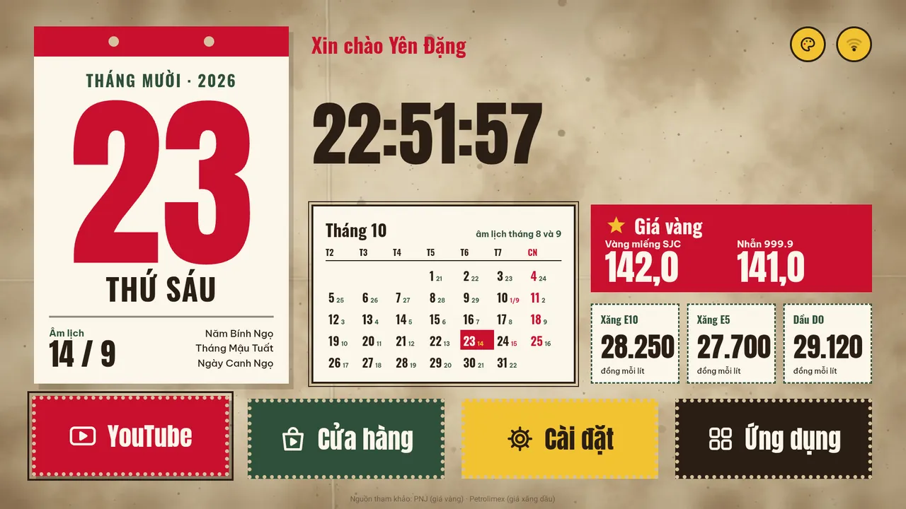 **Retro Việt Nam** (`retro`) | 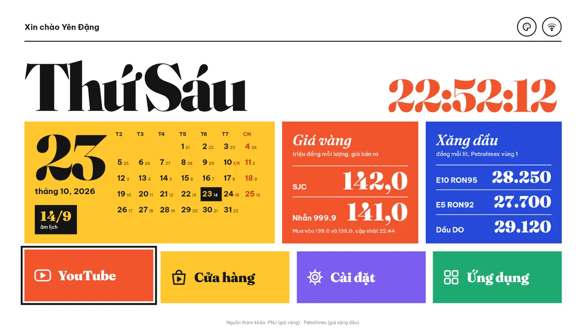 **Bìa tạp chí** (`magazine`) |
| 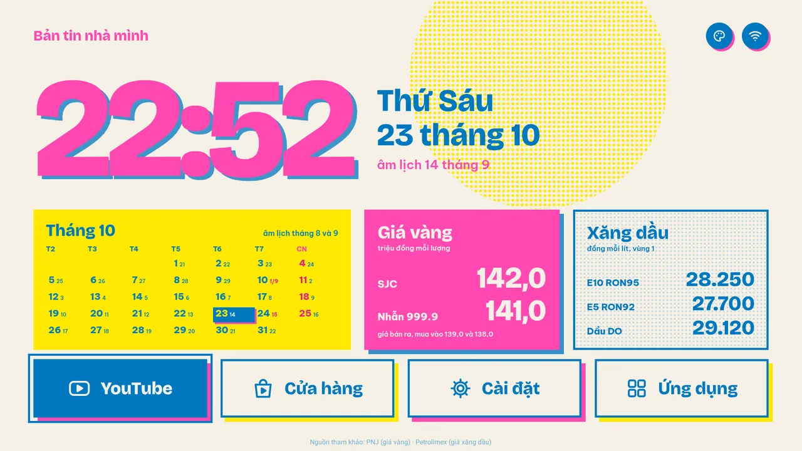 **Risograph** (`riso`) | 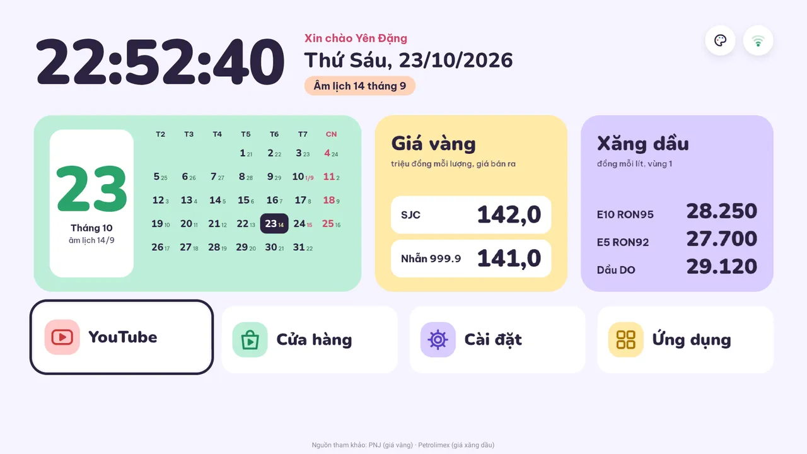 **Pastel tươi vui** (`pastel`) |
| 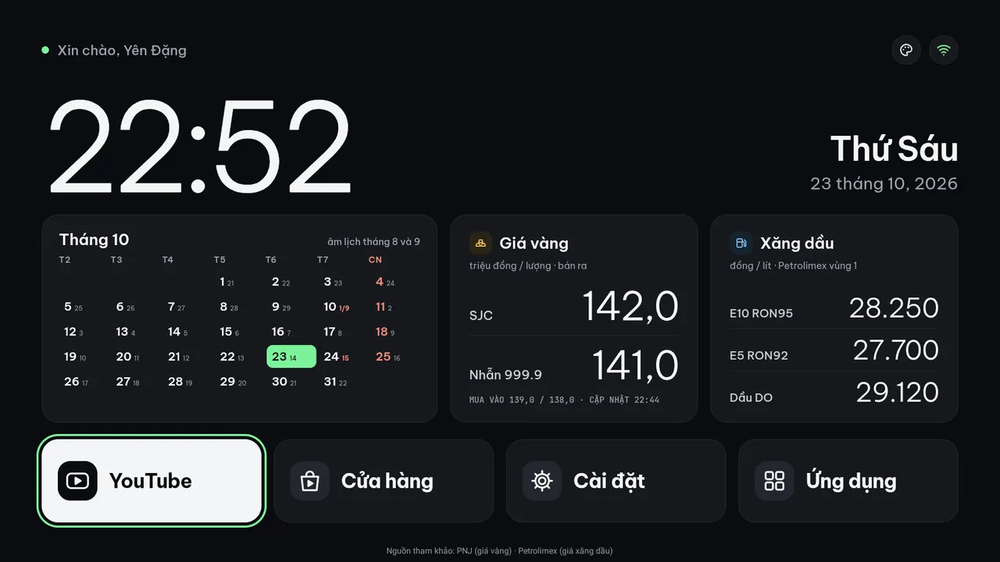 **Hiện đại tối giản** (`modern`) | 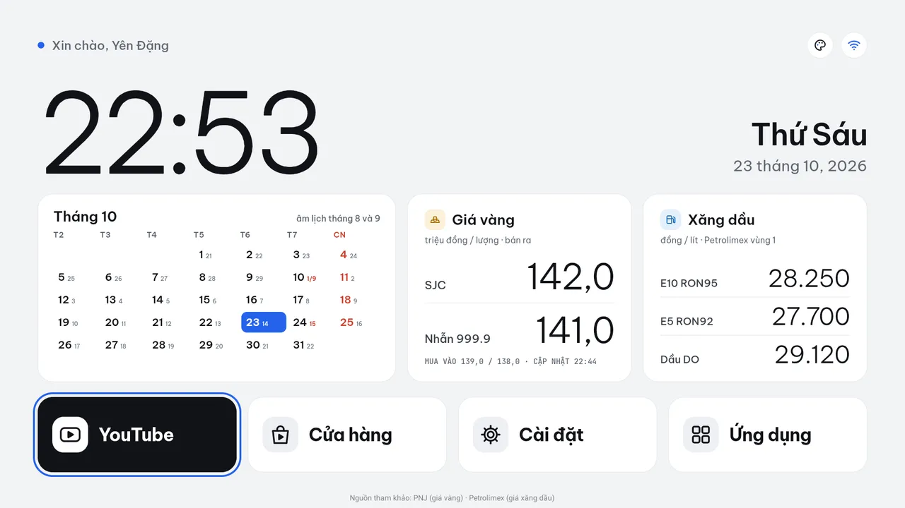 **Hiện đại sáng** (`modern-light`) |
| 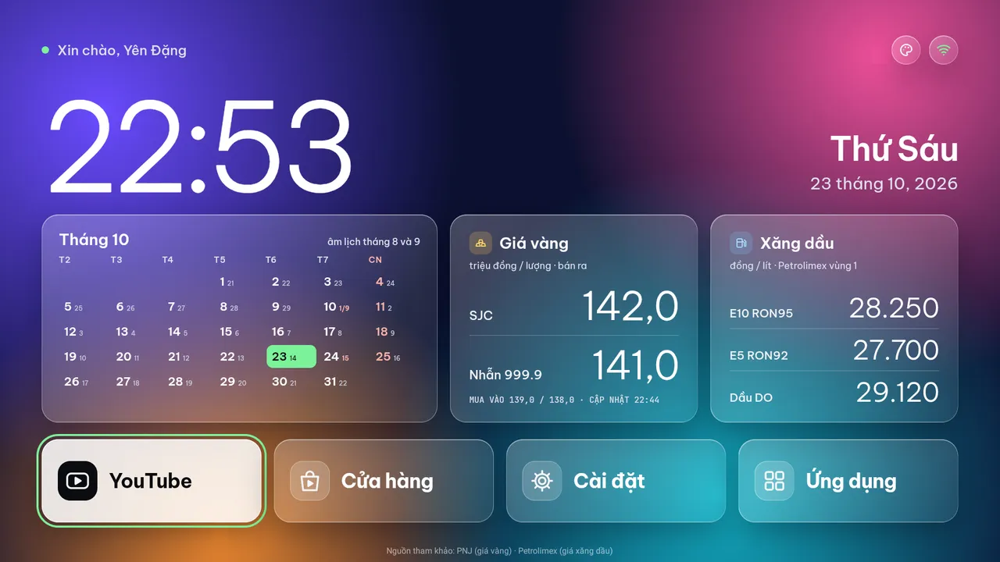 **Liquid Glass** (`liquid`) | 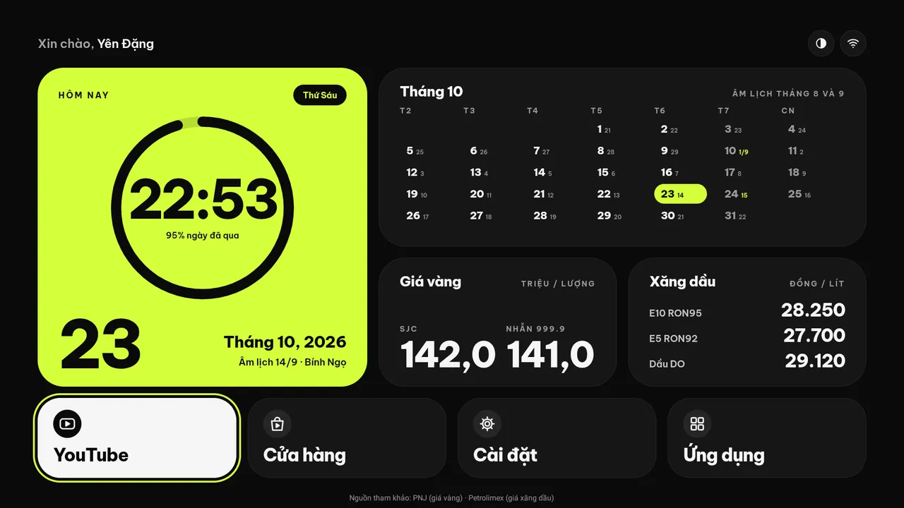 **Neon Ring** (`neon-ring`) |
| 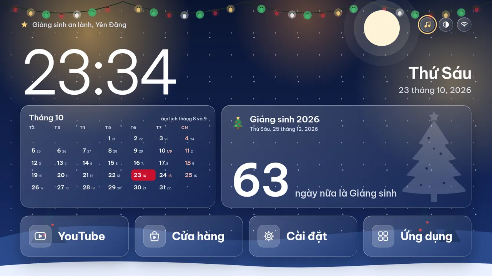 **Noel** (`noel`) | 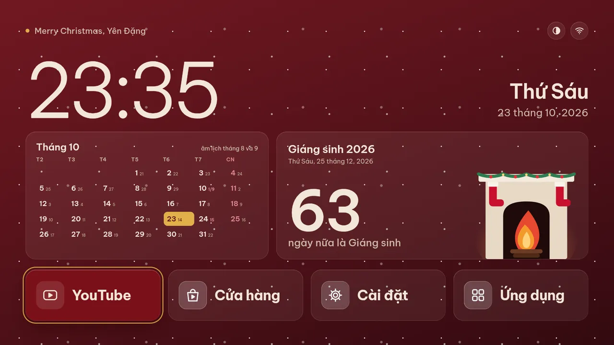 **Noel lò sưởi** (`noel-fireplace`) |
| 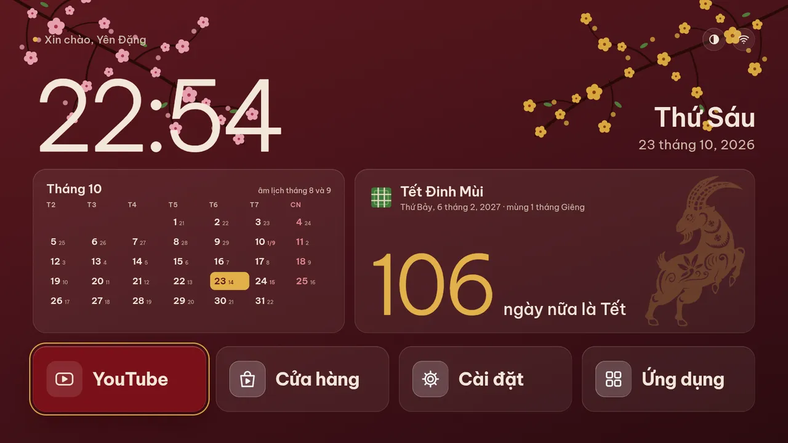 **Tết** (`tet`) | |

Screenshots taken on a VinSmart 4K TV (1920×1080) on 23/10/2026.

## What is TV Home?

TV Home is a home-made home screen for Android TV. It replaces the TV's default Google home screen and shows:

- a greeting with the owner's name, the clock and the date
- the lunar calendar and a month calendar
- Gold and fuel prices, updated every hour, once the app has a price source. It has none by default: the price tiles
  show "–" until you write one (see [Prices](#en-prices)).
- big tiles for YouTube, Play Store, Settings and the list of apps
- a button to switch themes. The Noel theme also plays music.

It comes with 11 themes (pictures above), and you can add more. It was made and tested on a VinSmart 4K TV
(`VINATV_4K`, model `TR2001`): Android 9, 2 GB RAM, 1920×1080 screen, ARMv7 chip.

## How does it work?

Each theme is a small web page (HTML, CSS) in `themes/themes/<name>/`. The Android app in `app/` shows that page full
screen and lets the remote move between the tiles.

You build the app on a computer (a Mac or Windows), which gives you one APK file. Then `adb` sends the APK to the TV over Wi-Fi, and you set
TV Home as the home screen.

A new theme only needs changes to the web page, never to the Android code.

## Step by step

Run the commands below in **Terminal** on a Mac (press ⌘ Space, type "Terminal", press Enter) or in **PowerShell** on
Windows (press the Windows key, type "PowerShell", press Enter). When a command differs between Mac and Windows, both are
given. Copy each command, paste it and press Enter. Each step says what the right result looks like; if you get something else, stop and ask
before going on.

**Fastest: use Claude Code.** Open the project in Claude Code and run `/setup`. Claude checks what the computer is missing
and installs it, prepares the project, tells you what to press on the TV, then builds, installs and sets TV Home as
the home screen. The steps below do the same, one command at a time.

### 1. Set up the project

Once per computer.

1. **Install these tools** (the default options are fine):

   | Tool | Download | Used for |
   |---|---|---|
   | Git | Mac: run `xcode-select --install` in Terminal, click Install. Windows: https://git-scm.com/download/win | getting the code |
   | Java 17 | https://adoptium.net/temurin/releases/?version=17 (Mac: the .pkg. Windows: the .msi, and tick **Set JAVA_HOME variable** while installing) | building the app |
   | Android Studio | https://developer.android.com/studio | the Android SDK and `adb` |
   | Node.js 20 or later | https://nodejs.org (LTS) | preparing the themes |
   | Google Chrome | https://www.google.com/chrome | theme preview pictures |

   Check: `node -v` prints `v20` or later. On a Mac, `/usr/libexec/java_home -v 17` prints a Java 17 path; on Windows,
   `java -version` prints version 17.

2. **Open Android Studio once** and click Next to the end, so it downloads the Android SDK. Then open
   **Settings → Languages & Frameworks → Android SDK**. Under "SDK Platforms", tick **Android 14 (API 34)**; under
   "SDK Tools", tick **Android SDK Build-Tools** and **Android SDK Platform-Tools**. Click OK.

3. **Get the code:**

   ```bash
   cd ~
   git clone https://github.com/yendangn/xyz-tvhome.git
   cd xyz-tvhome
   ```

4. **Point the project at the Android SDK and install its tools:**

   Mac:

   ```bash
   echo "sdk.dir=$HOME/Library/Android/sdk" > app/local.properties
   npm --prefix scripts install
   ```

   Windows:

   ```powershell
   "sdk.dir=$($env:LOCALAPPDATA -replace '\\','/')/Android/Sdk" | Out-File -Encoding ascii app/local.properties
   npm --prefix scripts install
   ```

   `app/local.properties` is for this computer only. Git already ignores it; do not commit it.

5. **Try a build:**

   ```bash
   # Mac
   JAVA_HOME=$(/usr/libexec/java_home -v 17) app/gradlew -p app assembleDebug
   # Windows
   .\app\gradlew.bat -p app assembleDebug
   ```

   The first run takes a few minutes. It is done when it prints **`BUILD SUCCESSFUL`**. On a Mac whose default Java
   is already 17, you can leave out `JAVA_HOME=…`.

> Each time you open a new Terminal (or PowerShell) window, run these two first. The second one makes `adb` available.
>
> ```bash
> # Mac
> cd ~/xyz-tvhome
> export PATH="$HOME/Library/Android/sdk/platform-tools:$PATH"
> # Windows
> cd ~\xyz-tvhome
> $env:Path += ";$env:LOCALAPPDATA\Android\Sdk\platform-tools"
> ```

### 2. Set up the TV

Once per TV.

1. **Turn on developer mode:** on the TV open **Settings → Device Preferences → About** and select **Build** about
   7 times, until the TV says "You are now a developer".
2. **Turn on debugging:** go back to **Device Preferences → Developer options** and turn on **USB debugging**. If
   there is **ADB over network** (network debugging), turn it on too.
3. **Get the TV's IP:** open **Settings → Network & Internet**, select your Wi-Fi and note the **IP address** (like
   `192.168.1.39`). In the commands below, `<tv-ip>` means this IP.
4. **Put the computer and the TV on the same Wi-Fi.**
5. **Connect the computer to the TV:**

   ```bash
   adb connect <tv-ip>:5555
   ```

   The TV asks **"Allow USB debugging?"**. Select **Always allow from this computer**, then **OK**.

6. **Check:**

   ```bash
   adb devices -l
   ```

   It is connected when there is a line like this, with `device` after the IP:

   ```
   192.168.1.39:5555      device product:TR2001_Vsmart model:VINATV_4K device:TR2001
   ```

   `unauthorized` means OK was not pressed on the TV: run `adb disconnect <tv-ip>:5555` and do step 5 again.

Give the TV a fixed IP in your router, so the IP stays the same after the TV restarts.

When the computer has more than one device connected (for example a phone on USB), every `adb` command needs
`-s <tv-ip>:5555`. The commands in this README already have it.

### 3. Add a theme

**Fastest:** in Claude Code run `/new-theme` and give it a design link, a picture or a description. Claude makes the
theme and its preview picture, and checks the build.

**One step at a time:**

A theme is one folder:

```
themes/themes/<id>/
  index.html      the page
  style.css       the theme's CSS
  theme.json      name, order and the look of the theme picker
  preview.webp    768×432 picture shown in the theme picker
  …               the theme's own images (WebP) and scripts
```

**3.1 Make the folder.** Pick an id in lowercase letters, digits and `-` (for example `tet-2027`), and a name to show
on the TV. List the ids already used, then make the theme:

```bash
node scripts/build-web.mjs --list
node scripts/new-theme.mjs tet-2027 "Tết 2027"
```

The second command copies the "modern" theme into a new folder that works at once. Its `style.css` is a full copy, so
change it freely. Do not edit `themes/shared/modern.css`: other themes share it.

**3.2 Look at it.** Drag `themes/themes/tet-2027/index.html` into Chrome. Prices and Wi-Fi only work inside the app.

**3.3 Restyle the page.** Change `index.html` and `style.css` to match the design, and keep these rules:

- `#stage` is 1920 wide and 1080 high, with `position: absolute; transform-origin: 0 0`. `core.js` scales it to the
  screen. Use px.
- Keep the buttons the remote moves between:
  - Top row (`data-nav="top"`): `data-action="themes"` is the **only** way to open the theme picker, so it must be
    there (the build fails without it); `data-action="wifi"` gets the class `off` when offline.
  - Dock (`data-nav="dock"`), all four tiles: YouTube `data-pkg="com.google.android.youtube.tv"`, Play Store
    `data-pkg="com.android.vending"`, `data-action="settings"` and `data-action="apps"` ("Ứng dụng": opens the TV's
    app list).
- The selected tile gets the class `focus`. Style `.focus` like the highlighted tile in the design. On load, YouTube
  is selected.
- Write the owner's name as `<span data-owner>Yên Đặng</span>`. The build puts the name from `themes/site.json` there,
  or removes the span (and the comma before it) when that name is empty.
- Put `<script src="../../core.js"></script>` last in `<body>`. Use relative paths: `../../fonts/…` for fonts,
  `./…` for the theme's own images.
- `core.js` fills elements by id. Use the ids for what the design shows (the full list is at the top of
  `themes/core.js`):

  | Group | Ids |
  |---|---|
  | Clock, date | `clock` (adds a `.sec` span for seconds; for HH:MM add `.clock .sec { display: none; }`), `hello`, `weekday`, `dayNum`, `monthNum`, `monthName`, `dateText`, `dateLong` |
  | Lunar calendar | `lunarLong`, `lunarShort`, `lunarSlash`, `ccYear`, `ccYearName`, `ccMonth`, `ccDay` |
  | Month grid | `cal` (gets `.six` for 6-row months), `calTitle`, `calSpan`, `calGrid` (each `.cell` has `<b>` for the day and `<i>` for the lunar day; classes `.sun`, `.special`, `.today`) |
  | Prices | `sjc`, `ring`, `sjcBuy`, `ringBuy`, `e10`, `e5`, `do`, `priceTime` |

- The theme's own script can use the lunar calendar: `window.lunar.of(day, month, year)` and
  `window.lunar.canChi(lunarYear)`. Example: `themes/themes/tet/tet.js`.
- Music: add `"music": "<file>.m4a"` to `theme.json`, put the file next to `index.html`, and add a
  `data-nav="top" data-action="music"` button. A button without music, or music without a button, fails the build.
  Music plays only after the button is pressed, and only while TV Home is in front. Example: `themes/themes/noel/`.

**3.4 Keep the TV fast.** The TV is weak, so:

- No `backdrop-filter`, no `filter: blur()`, no CSS `animation` that loops forever.
- Static gradients, hard shadows and `radial-gradient` patterns are fine: they are painted once.
- Images: WebP, at most 1920×1080, quality 80.
- For an effect that keeps going (blinking lights), use a timer in the theme's JS (`setInterval`, every 0.5–1 s) that
  changes classes. Make the changing parts HTML elements with `will-change: opacity`, change only `opacity` or
  `transform`, and never change SVG children. Example: `themes/themes/noel/noel.js`. Measured on the TV, 28 blinking
  lights done this way cost almost no CPU; the same lights as an SVG with a CSS animation cost about 24 % of a core.

**3.5 Fonts.** Use the fonts in `themes/fonts/` when you can. For a new font:

1. Download it from Google Fonts (`https://raw.githubusercontent.com/google/fonts/main/ofl/<family>/`) with its
   `OFL.txt`.
2. Install the tools: `python3 -m venv .venv && .venv/bin/pip install fonttools brotli`. On Windows use `python`
   instead of `python3`, and `.venv\Scripts\` instead of `.venv/bin/` in the commands below.
3. For a variable font, fix the weight you use: `.venv/bin/fonttools varLib.instancer in.ttf wght=800 -o out.ttf`.
4. Keep only Latin and Vietnamese letters and write woff2:

   ```bash
   U="U+0000-00FF,U+0131,U+0152-0153,U+02BB-02BC,U+02C6,U+02DA,U+02DC,U+0300-0301,U+0303-0304,U+0308-0309,U+0323,U+0329,U+0102-0103,U+0110-0111,U+0128-0129,U+0168-0169,U+01A0-01A1,U+01AF-01B0,U+1EA0-1EF9,U+2000-206F,U+20AB,U+20AC,U+2122,U+2191,U+2193,U+2212,U+2215,U+FEFF,U+FFFD"
   .venv/bin/pyftsubset out.ttf --unicodes="$U" --layout-features='*' --flavor=woff2 --output-file=themes/fonts/<Family>-<Style>.woff2
   ```

5. Copy the licence to `themes/fonts/<Family>-OFL.txt`. The build ships it with the font.

**3.6 The theme picker (`theme.json`).** The picker is native Android, styled per theme:

```json
{
  "name": "Tết 2027",
  "order": 110,
  "panel": { "scrim": "rgba(0,0,0,.6)", "panel": "#FFF8EC", "ink": "#3A1A0A",
             "titleFont": "fonts/panel/oswald_bold.ttf", "nameFont": "fonts/panel/oswald_bold.ttf",
             "tagFont": "fonts/panel/bevietnampro_bold.ttf", "tag": "#C8102E",
             "sel": "#3A1A0A", "selBg": "#F2C230" }
}
```

- `order`: place in the picker, smaller first. `new-theme.mjs` puts a new theme last.
- Required `panel` fields: `scrim`, `panel`, `ink`, `titleFont`, `nameFont`, `tagFont`, `tag`, `sel`, `selBg`.
  Optional fields and their defaults are in `app/src/main/java/com/xyz/tvhome/theme/ThemeStyle.kt`;
  `themes/themes/retro/theme.json` uses almost all of them.
- Colours: `#RRGGBB`, `#AARRGGBB` or `rgba(r,g,b,a)`. Sizes: px on the 1920×1080 stage.
- Picker fonts must be TTF files in `themes/fonts/panel/` (Android cannot read woff2).
- `footInk`: colour of the price-source line at the bottom of the screen (default: `ink`). Set it when `ink` is hard
  to read on the bottom of the page. `"showSource": false` hides that line, for a theme without prices.
- Keep the name short: a name that is too wide is cut with "…".

**3.7 Make the preview and try a build.**

```bash
node scripts/preview.mjs tet-2027
# Mac
JAVA_HOME=$(/usr/libexec/java_home -v 17) app/gradlew -p app assembleDebug -Pthemes=tet-2027
# Windows
.\app\gradlew.bat -p app assembleDebug -Pthemes=tet-2027
```

The first command captures the page at 1920×1080 in Chrome (with sample prices) and saves
`themes/themes/tet-2027/preview.webp`; open it and compare it with the design. `node scripts/preview.mjs --all` redoes
every theme. If Chrome is somewhere unusual, set `CHROME=/path/to/chrome` (Mac) or
`$env:CHROME="C:\path\to\chrome.exe"` (Windows).

The second command is a test build. A missing font, a missing image or a bad path fails it with a clear error. It is
fine when it prints **`BUILD SUCCESSFUL`**.

### 4. Build

**Fastest:** in Claude Code run `/build-release`. Claude asks which themes to include and whose name to greet, then
builds, and installs on the TV if you want.

**One step at a time:**

1. **Set the name in the greeting:** open `themes/site.json` and write the name, for example `{ "owner": "Yên Đặng" }`.
   With `""` the greeting is just "Xin chào".
2. **Build:**

   ```bash
   # Mac
   JAVA_HOME=$(/usr/libexec/java_home -v 17) app/gradlew -p app assembleRelease
   # Windows
   .\app\gradlew.bat -p app assembleRelease
   ```

   When it prints **`BUILD SUCCESSFUL`**, the app is **`app/build/outputs/apk/release/app-release.apk`**.

Options to add at the end of the build command:

| Add | What it does |
|---|---|
| `-Pthemes=retro,tet-2027` | only these themes (without it: all themes) |
| `-Powner="Another Name"` | another name in the greeting, for this build only |
| `-Pmusic=noop` | no theme music; the music button stays off |
| `-Pnode="$(command -v node)"` | when Gradle cannot find `node` (common when Android Studio is opened from the Dock) |

The build runs `scripts/build-web.mjs`. It copies into the APK only the files the chosen themes use, and minifies
HTML, CSS and JS for release. To list the themes: `node scripts/build-web.mjs --list`.

### 5. Install

1. **Connect to the TV** (do step 2 first if you have not):

   ```bash
   adb connect <tv-ip>:5555
   ```

2. **Install and open the app:**

   ```bash
   adb -s <tv-ip>:5555 install -r app/build/outputs/apk/release/app-release.apk
   adb -s <tv-ip>:5555 shell am start -n com.xyz.tvhome/.HomeActivity
   ```

   `Success` means it is installed, and TV Home opens on the TV. `install -r` replaces the old version and keeps the
   chosen theme and saved prices. When TV Home is already the home screen, the TV reopens the new version by itself.

3. **Make it the home screen** (once). Android TV 9 has no setting for this, so use these commands:

   ```bash
   adb -s <tv-ip>:5555 shell cmd package set-home-activity com.xyz.tvhome/.HomeActivity
   adb -s <tv-ip>:5555 shell pm disable-user --user 0 com.google.android.tvlauncher
   adb -s <tv-ip>:5555 shell am start -a android.intent.action.MAIN -c android.intent.category.HOME
   ```

   The first sets TV Home as the home screen. The second turns off the Google home screen, so Home does not go back
   to it. The last opens the home screen now; without it, press Home on the remote.

4. **Pick a theme:** on the TV, move up to the theme button in the top row, press OK and choose a theme.

5. **Turn developer mode off** (do this after installing, to lower the security risk):

   ```bash
   adb disconnect <tv-ip>:5555
   ```

   Then on the TV open **Settings → Device Preferences → Developer options**, turn off **USB debugging** and
   **network debugging**, then turn off the **Developer options** switch at the top. TV Home stays the home screen.
   To install a new version, go back to the Google home screen or uninstall later, turn them on again as in step 2.

**Back to the Google home screen:**

```bash
adb -s <tv-ip>:5555 shell pm enable com.google.android.tvlauncher
adb -s <tv-ip>:5555 shell cmd package set-home-activity com.google.android.tvlauncher/.MainActivity
adb -s <tv-ip>:5555 shell am start -a android.intent.action.MAIN -c android.intent.category.HOME
```

To use TV Home again, repeat step 5.3.

**Uninstall:** go back to the Google home screen first (the three commands above), then run:

```bash
adb -s <tv-ip>:5555 uninstall com.xyz.tvhome
```

Never uninstall TV Home before turning the Google home screen back on. The TV then falls back to **FallbackHome**,
an almost empty screen.

### Check the state

```bash
# The current home screen
adb -s <tv-ip>:5555 shell cmd package resolve-activity --brief -a android.intent.action.MAIN -c android.intent.category.HOME

# The app on screen now
adb -s <tv-ip>:5555 shell "dumpsys activity activities | grep -m1 mResumedActivity"

# Turned-off apps (com.google.android.tvlauncher in the list means the Google home screen is off)
adb -s <tv-ip>:5555 shell pm list packages -d

# TV Home errors (the web page logs with the tag TvHome)
adb -s <tv-ip>:5555 shell "logcat -d | grep -E 'TvHome|FATAL|AndroidRuntime'"
```

### Troubleshooting

| Problem | Cause and fix |
|---|---|
| `failed to connect … Connection refused` | Network debugging is off on the TV: redo step 2. Check the port with `nc -z -G 3 <tv-ip> 5555` (Mac) or `Test-NetConnection <tv-ip> -Port 5555` (Windows). |
| No answer, it times out | The TV is off, in deep sleep, or on another network than the computer. Try `ping <tv-ip>`. |
| `adb devices` says `unauthorized` | OK was not pressed on the TV. Run `adb disconnect <tv-ip>:5555`, connect again and press OK. |
| `more than one device/emulator` | Several devices are connected: add `-s <tv-ip>:5555`. |
| `adb: command not found` (Mac) or `The term 'adb' is not recognized` (Windows) | Run the command that adds `adb` to the PATH, at the end of step 1. |
| Home screen changed but the TV still shows the old app | `set-home-activity` applies from the next time Home opens. Press Home, or run the `am start … HOME` command from step 5. |
| Home opens an almost empty screen | The TV is on FallbackHome: no home screen is turned on. Run step 5.3, or go back to the Google home screen. |
| Connection lost after the TV restarts | Run `adb connect <tv-ip>:5555` again. If the IP changed, look it up again as in step 2. |

## For developers

- Folders:

  ```
  themes/
    core.js             shared by every theme: clock, lunar calendar, prices, Wi-Fi, remote focus
    fonts/              web fonts (woff2) and their OFL licences
    fonts/panel/        TTF fonts for the native theme picker
    shared/modern.css   shared layout of the modern themes (do not edit it for a new theme)
    site.json           the owner's name in the greeting
    themes/<id>/        index.html, style.css, theme.json, preview.webp, own images and scripts
  app/                  Android app (Kotlin, package com.xyz.tvhome): WebView, remote keys, prices, music, theme picker
    src/main/           shared code
    src/public/         LivePrices: the price source, empty by default, with an example in a comment
  scripts/              build-web.mjs (copies and minifies the chosen themes), new-theme.mjs, preview.mjs
  ```

- **Pull request checks.** Every pull request into `main` runs `check_pr` (GitHub Actions,
  `.github/workflows/check_pr.yml`): it installs the `scripts/` tools and builds the release APK. A pull request whose
  build fails cannot be merged. The APK of each run is under that run's Artifacts.

- <a id="en-prices"></a>**Prices.** Gold and fuel prices go through the `Prices` interface (`app/src/main/java/com/xyz/tvhome/prices/`).
  Every source hands over a `PriceBoard`; only `PriceBoard.toJson()` writes the JSON that `core.js` reads.

  | Field | Type | Unit |
  |---|---|---|
  | `sjc`, `ring` (SJC gold bar, 999.9 ring) | `GoldPrice(buy, sell, readAt)` | đồng per lượng, e.g. `142_000_000` |
  | `e10`, `e5`, `diesel` (E10 RON 95, E5 RON 92, DO 0.05S) | `FuelPrice(perLitre, readAt)` | đồng per litre, e.g. `29_050` |

  - `readAt` is when the price was read (epoch ms). A price not read again for 3 hours is dimmed; gold older than
    1 day and fuel older than 8 days shows "–". A product with no price is `null` and shows "–".
  - Prices out of range are dropped: gold outside 10–2,000 million per lượng or buy above sell, fuel outside
    10,000–80,000 đồng per litre.
  - The price source is `app/src/public/java/com/xyz/tvhome/prices/LivePrices.kt`. It is empty by default: no prices,
    and the price tiles show "–".
  - To show prices: open `app/src/public/java/com/xyz/tvhome/prices/LivePrices.kt`. At its end is a
    complete example inside a comment (fetches hourly, retries after failures, waits for the clock, refetches when the
    network is back). Uncomment it, delete the empty class above it, point `PRICES_URL` at your source, adapt `read()`
    to its format, and build as usual.

- <a id="en-music"></a>**Theme music.** The same way as prices: the `Music` interface (`app/src/main/java/com/xyz/tvhome/music/`) with
  `on`, `toggle()`, `theme(file)`, `show()`, `hide()`. There are `PlayerMusic` (default: MediaPlayer, only while Home
  is shown) and `NoopMusic` (`-Pmusic=noop`). A theme names its music with `"music"` in `theme.json` and has a
  `data-action="music"` button; the build fails when it has one without the other.

### <a id="en-bridge"></a>The bridge: page ↔ app

A theme page is a web page (HTML, CSS, JS) running inside the app. The page cannot open YouTube or fetch gold prices
by itself, and the app needs to tell the page when something happens (a key press, new prices…). The two talk through
the **bridge**, in two directions:

```
                  Direction 1: window.TV.launch(...), TV.prices(), …
  Theme page (JS) ─────────────────────────────────────────────────▶  App (Kotlin)
  themes/core.js     ◀─────────────────────────────────────────────────  HomeActivity
  your theme      Direction 2: nav(), refresh(), onPrices(), onNetwork()
```

| Direction | Who calls whom | List of calls | Implemented in |
|---|---|---|---|
| 1 | The page calls the app | `TvApi` (`app/src/main/java/com/xyz/tvhome/web/TvApi.kt`) | `Bridge.kt` |
| 2 | The app calls the page | `PageApi` (`app/src/main/java/com/xyz/tvhome/web/PageApi.kt`) | `Page.kt`, calling functions in `themes/core.js` |

#### Direction 1: the page calls the app (`window.TV`)

The app gives the page an object named `TV`. The page calls its methods to have the app do things:

| Method | Returns | Does |
|---|---|---|
| `TV.launch(pkg)` | — | Opens an app by package, e.g. `'com.google.android.youtube.tv'` |
| `TV.openSettings(which)` | — | `'wifi'`: Wi-Fi settings; anything else: the main Settings |
| `TV.openThemes()` | — | Opens the theme picker |
| `TV.openApps()` | — | Opens the TV's app list |
| `TV.online()` | `true` / `false` | Whether the network reaches the internet |
| `TV.prices()` | JSON string | Gold and fuel prices (see the example below) |
| `TV.musicOn()` | `true` / `false` | Whether the theme's music is on |
| `TV.toggleMusic()` | `true` / `false` | Turns the music on or off, and returns the new state |

**Way 1, no JS: `data-*` attributes.** Most buttons need only HTML. `core.js` handles moving with the remote,
highlighting the selected one (the `focus` class), and calling `TV` on OK:

```html
<div class="tile" data-nav="dock" data-pkg="com.netflix.ninja">Netflix</div>   <!-- on OK: TV.launch(...) -->
<div class="btn" data-nav="top" data-action="settings">…</div>                 <!-- on OK: TV.openSettings(...) -->
```

- `data-nav`: `top` is the top row of buttons, `dock` the row of big tiles at the bottom.
- `data-pkg`: the package of the app to open.
- `data-action`: `themes`, `wifi`, `music`, `apps` or `settings`.

**Way 2, call it in JS.** Write it in the theme's own script, after `core.js` in `index.html`:

```js
if (window.TV) {                                  // a page opened in Chrome has no TV, so check first
  TV.launch('com.google.android.youtube.tv');     // open YouTube
  var online = TV.online();                       // true / false, returned at once
}
```

**Reading prices:** `TV.prices()` returns a JSON string. A product missing from it has no price yet.

```js
var p = JSON.parse(TV.prices());
// p.sjc  = { buy: 138700000, sell: 141700000, t: <when it was read, ms> }   SJC gold, đồng per lượng
// p.ring = { buy, sell, t }                                                999.9 ring
// p.e10  = { price: 28250, t }                                             E10 petrol, đồng per litre (also e5, do)
if (p.sjc) show('sjc', (p.sjc.sell / 1e6).toFixed(1) + ' million');       // "141.7 million"
```

**Adding a method in direction 1:**
1. Declare it in `TvApi.kt`, with a note on what it does.
2. Implement it in `Bridge.kt`: `override fun …`, marked `@JavascriptInterface` (without it, JS cannot see it).
3. Add it to the table above.

#### Direction 2: the app calls the page

When something happens, the app calls a function in `core.js` so the page redraws:

| The app calls | When | What `core.js` does |
|---|---|---|
| `nav(dir)` | A remote key (theme picker closed). `dir` is `'left'`, `'right'`, `'up'`, `'down'`, `'ok'` or `'back'` | Moves the selection; `'ok'` presses the selected item |
| `refresh()` | Home comes back, or the TV sets its clock (e.g. after a power cut) | Redraws the date and time, prices, Wi-Fi, the music button; selects YouTube |
| `onPrices()` | New prices are in | Reads `TV.prices()` again and draws the prices |
| `onNetwork()` | The network comes or goes | Reads `TV.online()` again and draws the Wi-Fi icon |

**A theme that needs to do more** (say, redraw a Tết countdown) **wraps** the `core.js` function rather than replacing
it, so the shared part still runs:

```js
var before = window.refresh;
window.refresh = function () {
  if (before) before();   // core.js's own work: date, prices, Wi-Fi…
  drawCountdown();        // the theme's work
};
```

Do the same with `onPrices` and `onNetwork`. Real examples: `themes/themes/tet/tet.js`, `themes/themes/noel/noel.js`.

**Adding a function in direction 2:**
1. Write the function in `themes/core.js` and put it on `window` (like `window.onNetwork = net`).
2. Declare it in `PageApi.kt`, with a note on when the app calls it.
3. Implement it in `Page.kt`: `override fun … = js("window.name && name()")`.
4. Call it where the app needs it (usually `HomeActivity`), and add it to the table above.

#### Good to know

- Direction 1 is synchronous: JS gets the result only after the app has finished. Keep `TV.*` out of loops and
  per-second timers; read prices in `onPrices` and the network in `onNetwork`.
- Only strings, numbers and `true`/`false` pass. Anything with several parts comes back as a JSON string (like
  `TV.prices()`).
- Direction 2 never fails on a page without the function: the app calls it as `window.onPrices && onPrices()`.
- The lunar calendar is there for a theme's script: `lunar.of(25, 12, 2026)` gives the lunar date `{d, m, y, leap}`,
  `lunar.canChi(2026)` the year's name `"Bính Ngọ"`.
- For previews, `scripts/preview.mjs` stubs `TV` with sample prices, so the pictures show numbers.
